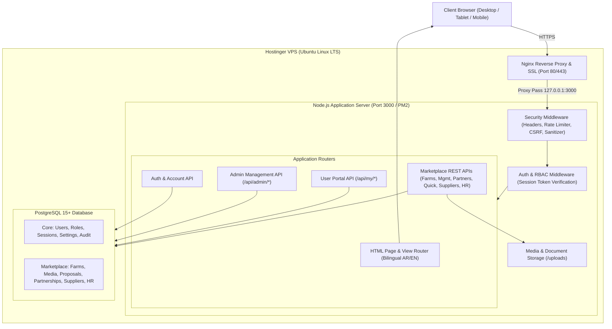
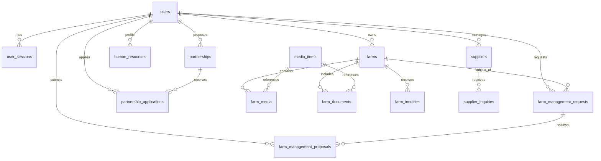

# FARMINN — Foundation Analysis, Architectural Blueprint & Implementation Plan

**Project Name**: FARMINN  
**Business Domain**: Agricultural Marketplace & Farm Management Platform  
**Target Hosting**: VPS Hostinger (Ubuntu Linux LTS, Nginx, PM2/systemd)  
**Database**: PostgreSQL 15+ (Single primary database, versioned additive SQL migrations)  
**Languages**: Arabic (`ar` — RTL) and English (`en` — LTR) strictly  
**Foundation Base**: Master Foundation v1.0.2  
**Functional Reference**: https://farm-exit-blond.vercel.app/en  

---

## 1. Existing Foundation Structure & Capabilities

Inspection of the `website starter FARMIN` workspace reveals a robust, security-first, modular architecture:

```text
website starter FARMIN/
├── AGENTS.md                          # Workspace directives & active project profiles
├── MASTER-INSTRUCTIONS.md             # Core governing engineering rules
├── README.md                          # Quick start and architecture overview
├── .env.example                       # Canonical environment template (secrets omitted)
├── .agents/skills/                    # 11 on-demand domain skills
├── config/
│   ├── languages.json                 # Language registry (ar, en enabled; fr, ru, de, es disabled)
│   ├── project.config.json            # Active FARMINN project configuration
│   ├── rbac.json                      # Role-permission matrix (super_admin, admin, editor)
│   ├── security-policy.json           # Session lifetimes, rate limits, lockouts, password policy
│   └── website-settings.schema.json   # Schema for centralized website settings
├── docs/
│   ├── ADMIN-SYSTEM.md                # 11-section admin dashboard architecture
│   ├── ARCHITECTURE-RULES.md          # Additive-only rules & cross-stack patterns
│   ├── AUTHENTICATION-ACCOUNT-MANAGEMENT.md # Auth flows, token lifecycle, session controls
│   ├── DATABASE-STRATEGY.md           # Single DB rules (PostgreSQL 15+ for VPS)
│   ├── DEPLOYMENT-GUIDE.md            # Hostinger VPS, systemd, Nginx, SSL instructions
│   ├── MULTILINGUAL-SYSTEM.md         # RTL/LTR handling, JSON dictionary governance
│   ├── RESPONSIVE-DESIGN.md           # Logical properties, breakpoint guidelines
│   └── SECURITY-POLICY.md             # OWASP Top 10 mitigation, rate limiting, sanitization
├── foundation/
│   ├── database/
│   │   ├── postgresql/001_core_schema.sql  # Production PostgreSQL starter schema
│   │   └── mysql/001_core_schema.sql       # MySQL fallback
│   ├── design-system/
│   │   ├── tokens.css                 # CSS custom properties (colors, typography, spacing)
│   │   ├── base.css                   # CSS reset, logical properties, RTL/LTR layout
│   │   └── components.css             # Buttons, inputs, modals, cards, tabs, pagination, toasts
│   ├── forms/validator.mjs            # Declarative validator emitting localized error keys
│   ├── i18n/
│   │   ├── ar.json / en.json          # Starter dictionaries
│   │   ├── i18n-helper.mjs            # Direction, cookie, and dictionary interpolation helper
│   │   └── translation-audit.mjs      # Key parity and orphan reference audit
│   ├── layouts/
│   │   ├── public-shell.html          # Public responsive shell with drawer & nav
│   │   ├── admin-shell.html           # Full 11-section admin dashboard blueprint
│   │   ├── auth-login.html            # Server-ready login blueprint
│   │   ├── auth-register.html         # User registration blueprint
│   │   ├── auth-forgot-password.html  # Non-enumerating forgot password blueprint
│   │   ├── auth-reset-password.html   # Expiring token reset blueprint
│   │   ├── auth-verify-email.html     # Email verification blueprint
│   │   └── shell.js                   # Client interactivity for shell components
│   ├── mail/email-templates.mjs       # Multi-language responsive email templates
│   ├── modules/                       # Reusable module blueprints (real-estate, tourism, etc.)
│   ├── security/
│   │   ├── csrf.mjs                   # Double-submit cookie & signed token CSRF defense
│   │   ├── input-sanitizer.mjs        # XSS prevention & HTML sanitization
│   │   ├── rate-limiter.mjs           # Sliding window memory/DB rate limiter
│   │   ├── token-utils.mjs            # Cryptographic tokens, bcrypt/argon2 hashing
│   │   ├── upload-policy.mjs          # Magic byte, MIME, extension, and file size validator
│   │   ├── security-headers.json      # Hardened HTTP response headers
│   │   └── security-regression.mjs    # Zero-dependency security regression suite
│   └── seo/
│       ├── robots.txt.template
│       ├── sitemap.xml.template
│       └── seo-meta.mjs               # Canonical, Open Graph, and hreflang generator
└── templates/
    ├── NEW-PROJECT-CHECKLIST.md
    ├── PROJECT-ARCHITECTURE.md
    └── PROJECT-CONFIG.md
```

---

## 2. What Can Be Reused Directly for FARMINN

The Master Foundation provides foundational assets that directly accelerate FARMINN without rewriting:

1. **PostgreSQL Core Schema (`001_core_schema.sql`)**:
   - `roles` and `role_permissions` (full RBAC framework).
   - `users` (multi-role user accounts with password hashes, avatars, status).
   - `user_sessions` (server-side token-hashed session tracking with IP and user-agent).
   - `password_reset_tokens` (single-use, expiring, non-enumerating tokens).
   - `email_verifications` (secure email activation flow).
   - `media_items` (centralized media registry with checksums, MIME types, folders, alt translations).
   - `website_settings` (dynamic key-value store for site identity, contact, WhatsApp, social links).
   - `security_audit_logs` (tamper-evident administrative audit trail).
   - `contact_inquiries` (generic message log).

2. **Security Infrastructure (`foundation/security/`)**:
   - Complete zero-dependency ES modules for CSRF protection, HTML sanitization, sliding-window rate limiting, cryptographic token generation, password verification, and strict file upload validation.
   - HTTP security headers specification matching Hostinger VPS Nginx reverse proxy.

3. **Design System & Responsive Primitives (`foundation/design-system/`)**:
   - `tokens.css`: Extensible CSS variables system.
   - `base.css`: Built from the ground up with CSS Logical Properties (`margin-inline`, `padding-block`, `inset-inline-start`), guaranteeing flawless RTL (Arabic) and LTR (English) rendering without layout duplication.
   - `components.css`: Production-ready styles for cards, forms, tables, badges, modals, drawers, tabs, alerts, and buttons.

4. **Bilingual Localization Infrastructure (`foundation/i18n/`)**:
   - Dynamic language switching helper (`i18n-helper.mjs`) tracking language preference in cookies, preserving routes, and setting `lang` and `dir` attributes automatically.
   - Parity auditor (`translation-audit.mjs`) verifying key synchronization between Arabic and English.

5. **Authentication Interface Shells (`foundation/layouts/`)**:
   - Accessible auth blueprints for login, registration, password reset, and verification.

6. **Centralized Administration Pattern (`foundation/layouts/admin-shell.html`)**:
   - Separation of **Website Settings** (public platform data) from **Account Settings** (personal admin profile).
   - Collapsible mobile-friendly sidebar, topbar, modal dialogs, and real-time metric cards.

---

## 3. What Needs Customization

1. **Multilingual Scope**:
   - Restrict active languages to **Arabic (`ar`, RTL)** and **English (`en`, LTR)**.
   - Disable `fr`, `ru`, `de`, `es` in project configuration while leaving dictionary files intact for backward compatibility.
   - Expand `ar.json` and `en.json` with comprehensive agricultural and marketplace terminology (e.g., Feddan, Qirat, Nile water rights, artesian wells, pivot irrigation, solar pumps, registered title deeds, agricultural engineer, farm management proposals).

2. **Visual Identity & Theme Tokens**:
   - Shift default colors from generic blue to an authentic, high-end agricultural palette:
     - **Primary Brand**: Deep Forest Green (`#1b4332`, `#2d6a4f`) representing fertile earth and agriculture.
     - **Brand Accent**: Warm Amber / Harvest Gold (`#d97706`, `#b45309`) representing vitality and investment.
     - **Surfaces**: Crisp clean card surfaces (`#ffffff`) over subtle organic stone tint (`#f6f8f6`).
     - **Typography**: `Cairo` / `IBM Plex Sans Arabic` for Arabic, paired with `Plus Jakarta Sans` / `Inter` for English.

3. **User Roles & Account Profiles**:
   - Add FARMINN specific user account types in addition to admin roles:
     - `buyer` (individuals or corporate buyers looking for farms or investments)
     - `seller` / `farm_owner` (owners listing farms for sale, rent, or management)
     - `farm_manager` (professional managers seeking management contracts)
     - `agricultural_engineer` (certified agronomists offering technical oversight)
     - `supplier` (companies offering agricultural equipment, seeds, fertilizers, irrigation)
     - `worker_specialist` (skilled farm labor and specialized technicians)

4. **Public Shell & Navigation**:
   - Update `public-shell.html` navigation links to:
     - Farms (`/farms` — Buy, Rent, Sale)
     - Farm Management (`/management`)
     - Partnerships & Investment (`/partnerships`)
     - Quick Buy (`/quick-buy`)
     - Quick Sell (`/quick-sell`)
     - Suppliers Directory (`/suppliers`)
     - Human Resources (`/human-resources`)
     - How It Works (`/#how-it-works`)
     - Sign In / User Dashboard (`/my`)
     - Language Switcher (`العربية` / `English`)

5. **Admin Dashboard Menu & Modules**:
   - Add specialized marketplace management sections to `admin-shell.html`:
     - Farms Management (moderation, publishing, status, documents review)
     - Management Requests & Proposals
     - Partnerships & Investment Requests
     - Quick Buy & Quick Sell Inquiries
     - Suppliers Directory Review
     - Human Resources & Professional Profiles Review
     - Taxonomy (Governorates, Farm Types, Irrigation, Crops)

---

## 4. Missing Features & Technical Requirements (What Must Be Implemented)

1. **Node.js HTTP Application Server & Router**:
   - An integrated, zero-dependency or lightweight Node.js runtime (`server.mjs`) serving the public website, user dashboard, admin dashboard, and REST API.
   - Static asset serving for CSS, client JS, and media uploads.
   - Secure session and cookie parsing middleware.

2. **PostgreSQL Database Connection & Migration Track**:
   - Database connection pool using `pg` connecting to Hostinger VPS PostgreSQL.
   - Additive migration runner applying `001_core_schema.sql` followed by `002_farminn_marketplace.sql`.
   - Seed script establishing realistic Egyptian agricultural geography (Governorates: Giza, Alexandria, Beheira, Matrouh, New Valley, Ismailia, Sharkia, Fayoum, Minya, etc.), farm categories, irrigation types, and admin credentials.

3. **FARMINN Marketplace Database Schema (`002_farminn_marketplace.sql`)**:
   - Detailed relational schema with foreign keys, constraints, and indexes covering all 8 platform pillars.

4. **REST API Endpoints**:
   - **Auth**: `/api/auth/register`, `/api/auth/login`, `/api/auth/logout`, `/api/auth/me`, `/api/auth/forgot-password`, `/api/auth/reset-password`.
   - **Farms Marketplace**: `/api/farms` (with multi-criteria filtering: purpose, governorate, size, price, sort), `/api/farms/:slug` (full detail with media, documents, amenities, specs), `/api/farms/submit` (listing creation).
   - **Farm Management**: `/api/management/requests` (submit and browse requests), `/api/management/proposals` (submit and review proposals).
   - **Partnerships**: `/api/partnerships` (browse investment opportunities), `/api/partnerships/apply` (application submissions).
   - **Quick Buy & Quick Sell**: `/api/quick-buy` (buyer asset requests), `/api/quick-sell` (owner fast sale requests).
   - **Suppliers Directory**: `/api/suppliers` (category and location filters, direct contact inquiries).
   - **Human Resources**: `/api/human-resources` (agronomists, managers, specialists with category and experience filters).
   - **User Dashboard (`/api/my/*`)**: Personal listings, personal requests, received proposals, profile management.
   - **Admin Management (`/api/admin/*`)**: Review, approve, reject, feature, archive, and delete operations across all marketplace entities, plus real dynamic database statistics.

5. **Production-Ready Public Interface Pages**:
   - Fully interactive, responsive HTML/CSS/JS views for all public and portal sections with complete bilingual AR/EN support.

---

## 5. Proposed FARMINN Architecture



---

## 6. Database Entities & Relationships Required

The following relational schema extends the Master Foundation's `001_core_schema.sql` via `002_farminn_marketplace.sql`:



### Key Database Tables:

1. **`taxonomy_locations`**:
   - `id`, `slug`, `name_en`, `name_ar`, `type` (`governorate`, `city`), `parent_id`, `sort_order`, `is_active`.
2. **`taxonomy_categories`**:
   - `id`, `slug`, `name_en`, `name_ar`, `module` (`farm_type`, `supplier_category`, `hr_specialty`, `partnership_type`), `sort_order`, `is_active`.
3. **`farms`**:
   - `id` (BIGSERIAL), `slug` (VARCHAR UNIQUE), `user_id` (BIGINT REFERENCES users), `purpose` (`sale`, `rent`, `both`), `title_en`, `title_ar`, `description_en`, `description_ar`, `governorate_id`, `location_text_en`, `location_text_ar`, `area_feddan` (NUMERIC), `area_qirat` (INT), `price` (NUMERIC), `price_per_feddan` (NUMERIC), `currency` (VARCHAR DEFAULT 'EGP'), `water_sources` (JSONB: Nile, artesian well, canal), `irrigation_systems` (JSONB: drip, pivot, flood), `electricity_source` (VARCHAR: grid, solar, generator), `soil_type` (VARCHAR), `legal_status` (VARCHAR: registered, primary contract, waiver), `facilities` (JSONB: villa, worker housing, storage, greenhouse, animal sheds), `status` (`draft`, `pending_review`, `approved`, `rejected`, `sold_or_leased`, `suspended`), `is_featured` (BOOLEAN), `view_count` (INT), `created_at`, `updated_at`.
4. **`farm_media`**:
   - `id`, `farm_id` (REFERENCES farms), `media_item_id` (REFERENCES media_items), `sort_order`, `is_cover`, `caption_en`, `caption_ar`.
5. **`farm_documents`**:
   - `id`, `farm_id`, `media_item_id`, `document_type` (`title_deed`, `water_permit`, `soil_analysis`, `survey_map`), `title_en`, `title_ar`, `is_verified` (BOOLEAN).
6. **`farm_inquiries`**:
   - `id`, `farm_id`, `user_id` (optional), `name`, `email`, `phone`, `whatsapp`, `message`, `status` (`new`, `contacted`, `closed`), `created_at`.
7. **`farm_management_requests`**:
   - `id`, `owner_id` (REFERENCES users), `farm_id` (optional), `title_en`, `title_ar`, `governorate_id`, `area_feddan`, `crop_type`, `required_services` (JSONB), `budget_min`, `budget_max`, `duration_months`, `details`, `status` (`open`, `reviewing_proposals`, `contracted`, `closed`), `created_at`.
8. **`farm_management_proposals`**:
   - `id`, `request_id` (REFERENCES farm_management_requests), `manager_id` (REFERENCES users), `proposed_fee`, `fee_type` (`fixed_monthly`, `profit_percentage`, `hybrid`), `proposal_details`, `duration_months`, `status` (`pending`, `accepted`, `rejected`), `created_at`.
9. **`partnerships`**:
   - `id`, `user_id` (REFERENCES users), `title_en`, `title_ar`, `governorate_id`, `area_feddan`, `required_capital`, `partnership_type` (`capital_investor`, `operating_partner`, `land_owner`), `equity_share_percent`, `objectives_en`, `objectives_ar`, `terms_conditions`, `status` (`active`, `funded`, `closed`), `created_at`.
10. **`partnership_applications`**:
    - `id`, `partnership_id`, `applicant_id` (REFERENCES users), `offered_capital`, `role_description`, `experience_summary`, `status` (`pending`, `accepted`, `declined`), `created_at`.
11. **`quick_buy_requests`**:
    - `id`, `user_id` (optional), `full_name`, `phone`, `whatsapp`, `governorate_id`, `min_area_feddan`, `max_area_feddan`, `available_cash`, `exchange_asset_type` (`real_estate`, `vehicle`, `equipment`, `none`), `exchange_asset_description`, `status` (`new`, `under_review`, `matched`, `closed`), `admin_notes`, `created_at`.
12. **`quick_sell_requests`**:
    - `id`, `user_id` (optional), `full_name`, `phone`, `whatsapp`, `farm_name`, `governorate_id`, `area_feddan`, `asking_price`, `accepts_installments` (BOOLEAN), `accepts_exchange` (BOOLEAN), `exchange_preferences`, `farm_details`, `status` (`new`, `evaluating`, `listed`, `declined`), `admin_notes`, `created_at`.
13. **`suppliers`**:
    - `id`, `user_id` (optional), `slug`, `company_name_en`, `company_name_ar`, `logo_media_id`, `category_id`, `description_en`, `description_ar`, `governorate_id`, `phone`, `whatsapp`, `email`, `website_url`, `products_services` (JSONB), `is_verified` (BOOLEAN), `status` (`active`, `pending`, `suspended`), `created_at`.
14. **`human_resources`**:
    - `id`, `user_id` (REFERENCES users), `slug`, `full_name_en`, `full_name_ar`, `professional_title_en`, `professional_title_ar`, `category_id` (engineer, manager, specialist, technician), `experience_years`, `governorate_id`, `bio_en`, `bio_ar`, `skills` (JSONB), `cv_media_id`, `phone`, `whatsapp`, `avatar_media_id`, `is_verified` (BOOLEAN), `status` (`active`, `pending`, `suspended`), `created_at`.

---

## 7. Phased Implementation Plan

| Phase | Milestone | Deliverables | Verification Gates |
| :--- | :--- | :--- | :--- |
| **Phase 1** | **Foundation Configuration & Dictionary Parity** | Update `config/project.config.json`, project configuration templates, and expand `foundation/i18n/` dictionaries (`ar.json` & `en.json`) with all FARMINN marketplace terms. | `node foundation/i18n/translation-audit.mjs` passes with 0 missing keys. |
| **Phase 2** | **PostgreSQL Schema & Migration Pipeline** | Author `foundation/database/postgresql/002_farminn_marketplace.sql` with full tables, foreign keys, triggers, and seed taxonomy. Implement database connection pool and migration runner. | Migration script runs successfully, tables and taxonomy verified. |
| **Phase 3** | **Backend API & Authentication Engine** | Build Node.js application server with REST endpoints for Auth, Farms, Management, Partnerships, Quick Buy/Sell, Suppliers, HR, User Dashboard, and Admin. Wire CSRF, rate limiter, and upload policy. | Security regression tests pass; endpoints return verified database results. |
| **Phase 4** | **Public Marketplace Interface** | Implement responsive, bilingual public pages (Home, Farms Catalog with filters, Farm Detail, Management, Partnerships, Quick Buy, Quick Sell, Suppliers, HR, About, Contact). | Flawless mobile & desktop rendering; seamless AR (RTL) and EN (LTR) switching. |
| **Phase 5** | **User Personal Dashboard (`/my`)** | Implement authenticated client portal for listing management, submitted requests, proposals review, and profile settings. | Role-protected operations; ownership validation on updates. |
| **Phase 6** | **Universal Admin Dashboard Customization** | Adapt `admin-shell.html` to manage all marketplace modules with real PostgreSQL operations and live metrics calculation. | Changes in admin reflect immediately on public site; zero mock numbers. |
| **Phase 7** | **Hostinger VPS Deployment Package & Handover** | Generate Nginx configuration, PM2 ecosystem script, systemd service file, and final project handover report. | Complete operational readiness for Hostinger VPS deployment. |

---

*Authored by Antigravity Lead Architect for FARMINN Project.*

